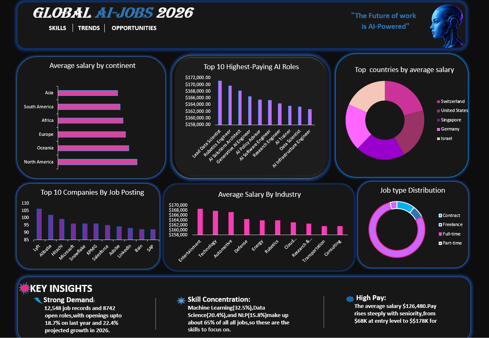

# Global AI Jobs Analysis

## Objective:
to Analyse the global AI jobs 2026 dataset and show where AI jobs are,which roles and industries pay the most.
How experience,education,and location affect salary,so job seekers can see which AI career paths and regions offer the best opportunities.

## Dataset Information:
The Dataset contains global AI job posting with key attributes,including:
Job ID,job title,AI Specialization, Industry,Company,Continent,Education Required and Salary.
The data was cleaned and prepared before visualization in Excel.

## Dashboard Features
The dashboard provides interactive visualization for:
Top highest paying job roles,country-wise job analysis,Industry and Company Analysis .
Shows which industries hire the most AI talent.

## Excel Functions Used:
-Pivot Tables to summarize salary,and experience level.
-Average of Salary to find average pay by role,country, and company.
-Top 10 Filter to show the highest paying roles.
-Pivot charts to visualize the results.

## Tools and Technologies:
Microsoft Excel, Pivot Tables,Pivot charts,Data cleaning,Kaggle Dataset.

## Key Insights:
- Identified the highest paying AI job roles using a Top 10 analysis
- Compared salary trends across countries and continents.
- Analyzed which industries hire the most AI talent.

